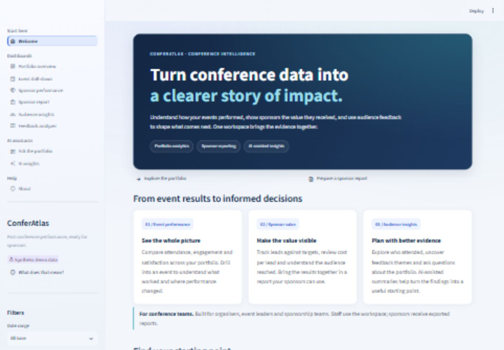
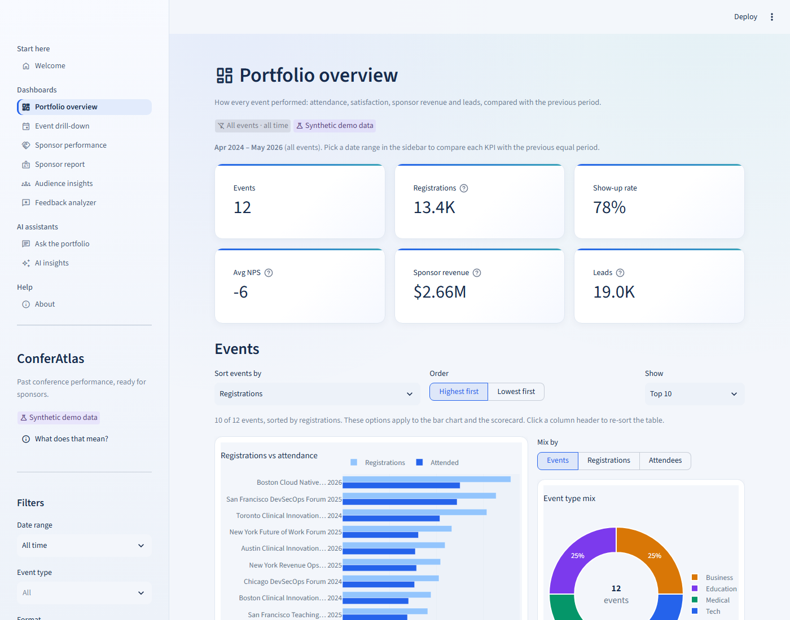
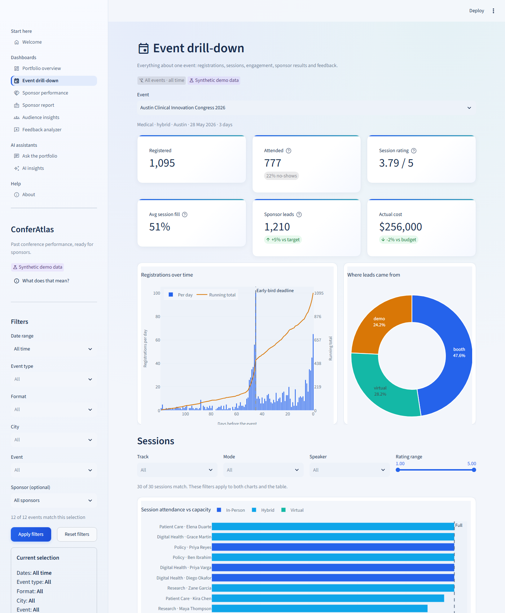
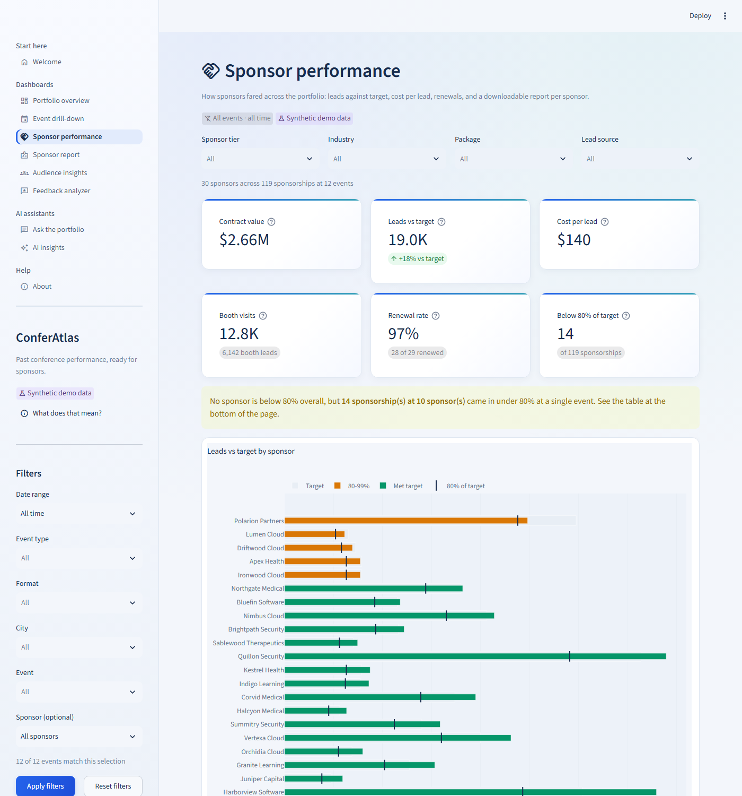
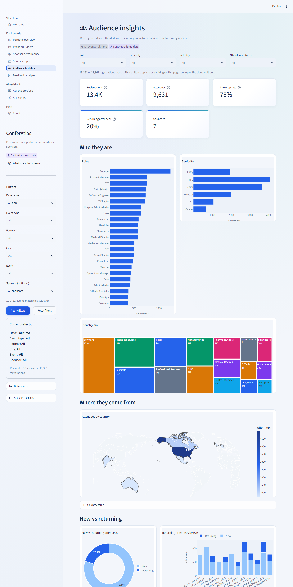
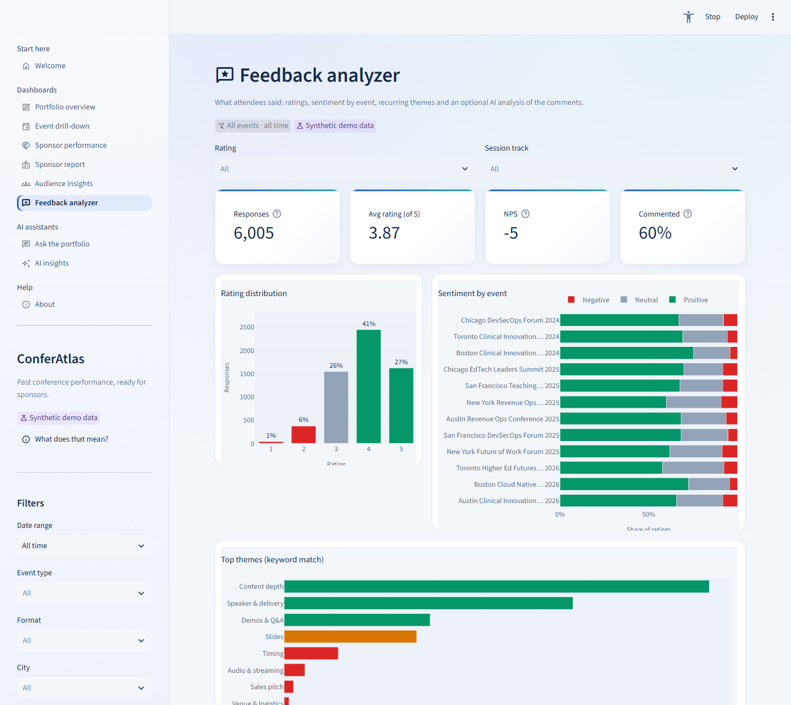
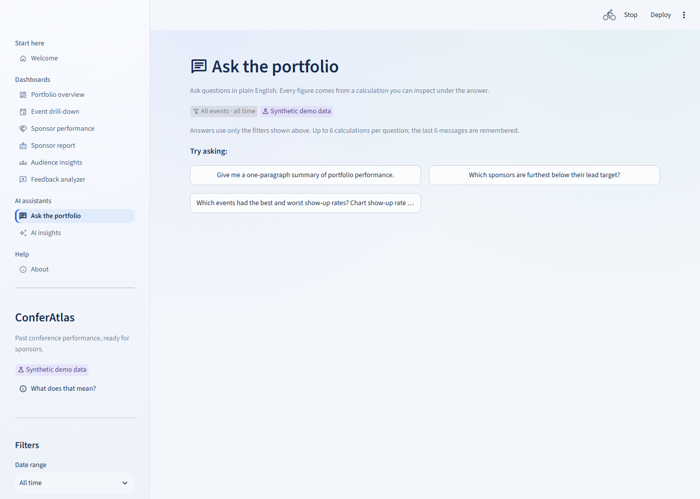
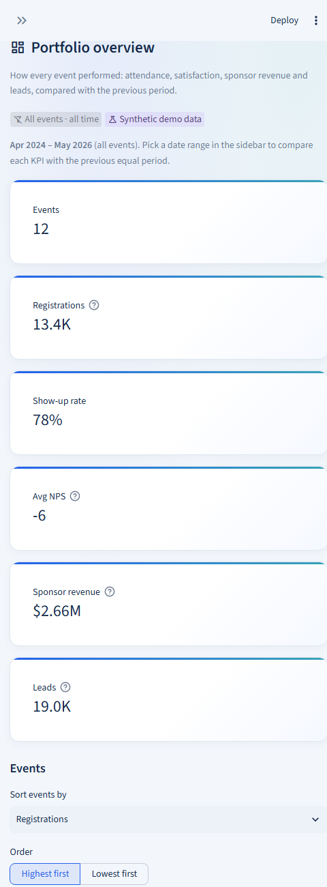

# ConferAtlas

**Past conference performance, ready for sponsors.** ConferAtlas is an AI-powered conference analytics app. It turns registration, session, engagement, lead and feedback data into dashboards, sponsor scorecards and AI-written summaries, and every number can be traced back to a calculation.

Built as two applications: a **FastAPI** backend (pandas analysis and **LangChain** AI, OpenRouter with Gemini by default) and a **Streamlit** frontend (**Plotly** charts) that only presents what the backend computes.

**Week 2 added document search (RAG):** the assistant also searches post-event reports, pricing brochures, sponsor decks, operations SOPs and session abstracts, cites the passages it used, and says "I couldn't find this in our documents" when they don't hold the answer. A **RAG Lab** page shows how documents are chunked, how search scores them and where they sit in embedding space, and an evaluation on 20 golden questions measures it. See [Document search (RAG)](#document-search-rag).

**Week 3 added a multi-agent Sponsor Renewal Desk:** a Deep Agent orchestrator plans one renewal pack per sponsor and hands the work to four specialists (analyst, package advisor, writer, reviewer). They use the Week 1 figures, the Week 2 document search and next year's pricing; a code checklist verifies every number, and a person approves, edits or rejects every pack before it is saved. Nothing is ever sent. See [Sponsor Renewal Desk (multi-agent)](#sponsor-renewal-desk-multi-agent).

> **The bundled data is synthetic.** Every event, sponsor, attendee and comment in `data/synthetic/` was generated by `scripts/generate_data.py` (fixed seed 42) to demonstrate the app. Names are invented. Do not use these figures for real decisions.

---

## Contents

- [Purpose](#purpose)
- [Who it is for](#who-it-is-for)
- [Screenshots](#screenshots)
- [Features by page](#features-by-page)
- [Document search (RAG)](#document-search-rag)
- [Sponsor Renewal Desk (multi-agent)](#sponsor-renewal-desk-multi-agent)
- [Setup and run](#setup-and-run)
- [Configuration](#configuration)
- [How it works](#how-it-works)
- [Data](#data)
- [Testing](#testing)
- [Troubleshooting](#troubleshooting)
- [Roadmap](#roadmap)

---

## Purpose

Sponsors renew when they can see what they got. Conference teams usually have the evidence (registrations, badge scans, session ratings, leads), but it is spread across tools and rarely shown in a form a sponsor trusts. ConferAtlas brings it together and answers three questions:

1. **How did our events perform?** Attendance, show-up rate, satisfaction, budget, and trends against the previous period.
2. **What did each sponsor get?** Leads against target, lead sources, cost per lead, the audience they reached, and renewal history.
3. **What should we change?** Feedback themes, weak sessions, sponsors at risk, and AI-written summaries grounded in the figures.

**Guiding rule:** the analysis layer computes every number. AI features only explain those numbers; they never calculate them or see individual attendee records.

## Who it is for

| User | What they do with it |
|---|---|
| **Conference executives and organisers** (primary users) | Review portfolio performance, drill into events, spot sponsors below target, analyse feedback, ask questions in plain English, and prepare sponsor reports. |
| **Sponsors** (audience for the outputs) | Receive scorecards and downloadable Markdown reports showing audience reached, engagement and leads against target, with every event named and every figure sourced. The app is designed so a sponsor can be walked through it live. |
| **Attendees** (the people in the data) | Not direct users. Their registrations, session engagement and comments are what the app analyses, and their feedback is turned into actions for future events. Portfolio chat and reports use aggregates. Feedback AI sends comment text after common-contact redaction; real comments require review because names and other identifiers may remain. The demo contains no real people. |

## Screenshots

> Placeholders. Capture each page at about 1400×900 with the demo data and save it to the path shown. See [`docs/screenshots/README.md`](docs/screenshots/README.md).

| Page | Screenshot |
|---|---|
| Welcome |  |
| Portfolio overview |  |
| Event drill-down |  |
| Sponsor performance |  |
| Audience insights |  |
| Feedback analyzer |  |
| Ask the portfolio |  |
| Mobile view |  |

## Features by page

The app opens on **Welcome**, an introduction to the platform with starting points for portfolio analytics,
sponsor reporting, audience insights and feedback. Existing dashboards remain available in the sidebar.

**Everywhere**
- **Global filters** (sidebar): date range (quick picks or custom dates), then event type → format → city → event, each narrowing based on the earlier choices, plus an optional sponsor. **Apply** / **Reset**, a *Current selection* card, and filtered data cached per selection.
- **Consistent page headers:** title, one-line description, and chips for the active filters and the data source (synthetic demo or uploaded).
- **Empty states** with a one-click *Reset all filters*, loading spinners, compact numbers (13.4K, $2.66M) with exact values on hover, readable chart labels, and a phone-friendly layout.
- **AI usage panel** (sidebar): every LLM request with tokens, estimated cost, latency and status, plus session totals.
- **Works without an API key:** all dashboards work fully, and each AI feature explains what is missing.

| Page | What it shows |
|---|---|
| **Portfolio overview** | KPI cards (events, registrations, show-up rate, average NPS, sponsor revenue, leads) with change vs the previous equal period; registrations vs attendance by event; monthly registration trend; event type mix; a sortable event scorecard with sort-by, order and top-N options and CSV download. |
| **Event drill-down** | One event's KPIs; registration curve by days before the event (early-bird spike marked); lead sources; session attendance vs capacity; engagement per attendee by session mode (in-person / hybrid / virtual); a session table with track, mode, speaker and rating-range filters; sponsor results and feedback tabs. |
| **Sponsor performance** | Filters for tier, industry, package and lead source. KPI cards: contract value, leads vs target, cost per lead, booth visits, renewal rate, sponsorships below 80%. Leads vs target by sponsor (colour-banded, with an 80% marker); lead source mix; revenue by tier; a scorecard with rows below 80% highlighted. **Generate sponsor summary** writes a report with the Sponsor Report Writer skill, runs its checklist and offers a Markdown download. |
| **Sponsor report** | One sponsor across every event they sponsored: leads vs target per event, lead sources, cost per lead and what leads said. |
| **Audience insights** | Filters for role, seniority, industry and attendance status. Role and seniority breakdowns, an industry treemap, a world map of attendees by country, and new vs returning attendees overall and per event. |
| **Feedback analyzer** | Filters for rating and track. Rating distribution, sentiment by event, keyword themes. **Analyse feedback** sends the filtered comments to the LLM in batches and returns structured themes (name, count, quote), overall sentiment, top 3 actions and a theme and sentiment tag per comment. |
| **Ask the portfolio** | Chat with a tool-calling agent over six fixed analysis tools and, when document search is on, one search tool per document collection. Every number must come from a tool result; each answer has a *View calculations* expander; charts can only use computed results; starter questions are offered. With documents, answers cite passages as [S1], [S2], and show **Sources** (cited and retrieved) and **How this was answered** (the plan, each tool call and what it returned). |
| **AI insights** | An AI-written event pitch for sponsors, or a renewal brief for one sponsor, from computed figures (a rule-based summary without a key). |
| **RAG Lab** | **Chunks:** one document cut by two chunking settings side by side, chunk by chunk, plus the size of every chunk in the corpus. **Search:** a tuning panel (index, dense / BM25 / hybrid, hybrid weight, candidates, top-k, re-ranking, refusal threshold) and an inspector showing every candidate's scores, how re-ranking moved it and the refusal line; unindexed chunk sizes can be built on the spot. **Embedding map:** every chunk in 2D with a question placed among them. **Experiments:** the evaluation results. |
| **Sponsor renewals** | Pick a tier (lowest lead attainment first) or up to 5 sponsors and press **Generate renewal packs**. While the agents work, the page shows the orchestrator's **plan** (its todo list, with a status per sponsor) and the **agent activity** (who did what). Each pack that waits for you shows its 7 checks, the draft and what we remember about the sponsor: **Approve**, **Approve with my edits** or **Reject with feedback** (the writer redrafts it). Approved packs can be downloaded; earlier runs can be reopened, even after a restart. |
| **About** | Explains that the demo data is synthetic, how every metric is calculated, and what the AI can see. |

## Document search (RAG)

Week 1 answers numeric questions from the CSVs. Week 2 adds the documents behind those numbers, so the assistant can answer "what went wrong", "what did we promise" and "what does it cost" with citations. Step-by-step build notes, with the reason for each choice, are in [`docs/week2/build-guide.md`](docs/week2/build-guide.md); the prompts used are in [`docs/week2/build-prompts.md`](docs/week2/build-prompts.md).

**The corpus:** 36 synthetic documents generated from the same seed as the CSVs, so every figure matches the dashboards, plus facts that exist only in the documents (venue issues, sponsor requests, prices, SOP rules), so answering needs retrieval.

| Collection | Files | Content |
|---|---|---|
| Event reports | 12 PDFs | Summary, audience, program, venue and operations, a sponsor results table, lessons learned |
| Pricing | 2 PDFs (2025, 2026) | Packages, add-ons, payment and cancellation terms, the 2026 lead guarantee |
| Sponsor decks | 6 PowerPoints | Partnership reviews with speaker notes, including next year's proposal |
| Operations | 4 Word documents | SOPs for venue setup, registration desk, booth logistics, streaming |
| Session abstracts | 12 Markdown files | The ten best-attended sessions per event |

**How it works:**

```
PDF, Word, PowerPoint, Markdown ─▶ loaders + cleaner ─▶ chunks (+ contextual header) ─▶ Qwen3-Embedding-8B ─▶ Chroma
                                                                                                        │
question ─▶ Ask agent ─▶ numeric tools (Week 1)  +  one search tool per collection ─▶ dense + BM25 ─▶ FlashRank re-rank
                                                                                                        │
          answer with [S#] citations, or "I couldn't find this in our documents"  ◀── refusal threshold ◀┘
```

- **Loaders** read PDFs page by page (headings by font size, tables as Markdown, repeated headers, footers and page numbers removed, ligatures normalised), Word documents by section, slides with their speaker notes, and Markdown by section, into one Document shape with 13 metadata fields.
- **Chunking** has three strategies for comparison: fixed 500-token windows with 50 overlap, structure-aware chunks of up to 400 tokens (one per section; the default) and semantic chunks. Each chunk starts with a header naming its document, section and page.
- **Index:** one Chroma collection per document collection and chunking setting, built with Qwen3-Embedding-8B (4096 dimensions) on Nebius. Rebuilds re-embed only changed documents, and every vector is cached on disk.
- **Search:** dense (cosine) and BM25 keyword scores, mixed 50/50, the top 20 re-ranked by a small CPU cross-encoder (FlashRank) to the top 5; the sidebar filters narrow it to the selected events. Below the threshold, nothing is returned.
- **Agentic RAG:** the agent routes each part of a question to a numeric tool or the right search tool, cites what it uses, and must refuse when the evidence doesn't answer. Retrieved text is treated as quoted data, never as instructions.
- **Final answer check (in code):** after the one tool reminder and the one rewrite for untraced figures, whatever is still unsupported is withheld rather than shown with a warning: each sentence with a figure no tool returned or a citation that was never retrieved, a non-refusal when every search came back empty, and an answer that used no tool at all. The Ask page says what was withheld and why, and the evaluation reports retrieval and final-answer quality separately (where the misses come from). Document search is off for uploaded datasets, because the documents describe the demo events.

### Setup

Click-by-click instructions are in section 0 of the [build guide](docs/week2/build-guide.md). In short, add to `backend/.env`:

```
# Nebius (embeddings and answers): key from tokenfactory.nebius.com
NEBIUS_API_KEY=...
NEBIUS_BASE_URL=https://api.tokenfactory.nebius.com/v1
EMBEDDING_PROVIDER=nebius
EMBEDDING_MODEL=Qwen/Qwen3-Embedding-8B
LLM_PROVIDER=nebius
LLM_MODEL=deepseek-ai/DeepSeek-V4-Flash-0731

# LangSmith (tracing and evaluation): smith.langchain.com > Settings > API Keys
LANGSMITH_TRACING=true
LANGSMITH_API_KEY=...
LANGSMITH_PROJECT=conferatlas
```

Check the Nebius key and see which models it can use:

```bash
.venv\Scripts\python.exe scripts\check_nebius.py --chat deepseek-ai/DeepSeek-V4-Flash-0731
```

**Chroma** needs no account: it runs inside the backend and saves to `data/index/chroma` (ignored by Git). LangSmith traces contain prompts and retrieved text, so keep tracing on for the synthetic demo data only, and use a Tracing-only key on a shared deployment.

### Build the index

```bash
.venv\Scripts\python.exe scripts\generate_data.py          # CSVs, the 36 documents and the golden set (already bundled)
.venv\Scripts\python.exe scripts\build_index.py            # the structure-aware index the assistant uses
.venv\Scripts\python.exe scripts\build_index.py --strategy all   # also fixed and semantic, for comparisons
.venv\Scripts\python.exe scripts\build_index.py --status   # collections, model, dimensions, chunk counts
.venv\Scripts\python.exe scripts\plot_embeddings.py --question "Which sponsor asked for attendee job titles?"
```

The first full build embeds about 1,700 texts (a few minutes); later builds take seconds and send only changed text to the model. The last command writes `data/index/embedding_map.html`.

### Run the evaluation

```bash
.venv\Scripts\python.exe scripts\run_eval.py                    # retrieval and agent experiments
.venv\Scripts\python.exe scripts\run_eval.py --retrieval-only   # no LLM calls
.venv\Scripts\python.exe scripts\run_eval.py --questions 3      # quick smoke run
.venv\Scripts\python.exe scripts\run_eval.py --agent fixed --merge   # rerun one setting, keep the rest
```

The 20 golden questions (`data/synthetic/eval/golden_set.json`) cover single-document, table, multi-document, mixed numeric-and-document and 3 unanswerable questions. Retrieval experiments (no LLM) compare 3 chunking settings x dense / hybrid / hybrid + re-rank; agent experiments run the whole assistant (answers by DeepSeek-V4-Flash) and an LLM judge from a different model family (GLM-5.3) scores faithfulness, relevance and correctness. With LangSmith configured, the golden set becomes a dataset and each setting an experiment to compare side by side. Results go to [`docs/week2/eval_results.md`](docs/week2/eval_results.md) and the RAG Lab Experiments tab. A full run costs roughly $1 to $2 of Nebius credit.

### Results

End to end (all 20 questions; hit rate and MRR over the 17 answerable ones):

| Setting | Hit rate | MRR | Routing | Refusal | Faithfulness | Relevance | Correctness | Judged | Withheld | ≤ 8 s | Median s |
|---|---|---|---|---|---|---|---|---|---|---|---|
| **structure · hybrid + re-rank (production)** | 100% | 1.00 | 100% | 95% | 98% | 100% | 100% | 19/20 | 0% | 90% | 3.57 |
| structure · dense | 100% | 1.00 | 100% | 95% | 97% | 100% | 100% | 19/20 | 0% | 100% | 2.24 |
| semantic · hybrid + re-rank | 100% | 1.00 | 100% | 95% | 98% | 100% | 99% | 19/20 | 0% | 95% | 3.12 |
| fixed · hybrid + re-rank | 100% | 1.00 | 100% | 70% | 94% | 82% | 82% | 17/20 | 0% | 55% | 7.04 |

These are from the rerun with the final answer check. Withheld is how often the check withheld claims; it removed none of these answers, and the scores match the run before it (production then: 100% faithfulness, 99% correctness, median 2.53 s; the latency difference is the provider on the day).

**Where the misses come from** (retrieval and final-answer quality measured separately, on the answerable questions the judge graded; an answer counts as right at 75% correctness or more):

| Setting | Retrieval right, answer right | Retrieval right, answer wrong (answer stage) | Retrieval missed, answer wrong (retrieval stage) | Correctness when retrieval was right |
|---|---|---|---|---|
| structure · hybrid + re-rank (production) | 17/17 | 0 | 0 | 100% |
| structure · dense | 17/17 | 0 | 0 | 100% |
| semantic · hybrid + re-rank | 17/17 | 0 | 0 | 99% |
| fixed · hybrid + re-rank | 12/15 | 3 | 0 | 80% |

Retrieval only: MRR rises from 0.87 (fixed, dense) and 0.93 (structure-aware, hybrid) to 1.00 with re-ranking, at about 1 s per search. What the numbers taught us:

- **Re-ranking puts the answer first.** For "which sponsor asked for attendee job titles", dense search ranked the answer chunk third; hybrid search and re-ranking put it first.
- **A correct tokenizer fix lowered hybrid search alone.** BM25 kept punctuation on words, so "2024:" in a heading never matched "2024" in a question. Fixing it made the headers count, but every chunk of a report repeats the same header words, so sibling chunks now tie: hybrid MRR without re-ranking fell from 0.96 to 0.93 (structure-aware) and 0.92 to 0.83 (semantic). Re-ranking reads the question and chunk together and absorbs it (still 1.00), which is one more reason it stays on.
- **Chunk size has to fit the context per source.** Fixed 500-token chunks were cut by the 1,200-character limit on each source given to the model, so the answer was often missing and the agent refused. The stage breakdown confirms it: all 3 fixed-chunk misses happened after the right document was retrieved, so the problem is in the answer stage (what the model is given), not in search.
- **Withhold, don't warn.** After the tool reminder and the one rewrite, the final check withholds an answer that used no tool, claims made when every search came back empty, and each sentence with an untraced figure or a citation that was never retrieved. On the golden set it withheld nothing, so it cost no correct answers; its tests cover each case it acts on.
- **Retrieval scores can't detect an unanswerable question about a real event** (a related chunk always scores well), so the agent also checks that the evidence actually answers; that took refusal accuracy from 85-90% (retrieval alone) to 95%.
- **One golden question was ambiguous:** "the dates of next year's events" was meant to be unanswerable, but the data has 2026 events, which the agent listed with citations.
- **Evaluate the evaluator:** the reasoning judge first left up to half the answers ungraded; the "Judged" column shows how many were graded, so a missing grade can't hide in an average.

## Sponsor Renewal Desk (multi-agent)

Week 3 turns the roadmap's multi-agent idea into a working desk. A sponsorship manager asks for renewal packs ("the 3 gold sponsors with the lowest lead attainment"); a team of agents researches each sponsor, recommends next year's package from the 2026 pricing, writes the pack and checks it; the manager approves each one. It is built with [Deep Agents](https://github.com/langchain-ai/deepagents) (LangChain's planning, sub-agent, file and human-approval layer on LangGraph), in the style of the course's GTM Deep Agent, with ConferAtlas's own tools, checks and data.

```
manager ─▶ Sponsor renewals page ─▶ POST /renewals (background thread) ─▶ orchestrator (Deep Agent)
                                                                             │ write_todos: one item per sponsor
                                                                             │ task ▶ analyst ───────── sponsor_facts (Week 1) + search decks / event reports (Week 2)
                                                                             │ task ▶ package advisor ─ search pricing (2026 prices, add-ons, terms)
                                                                             │ task ▶ writer ────────── sponsor-renewal-pack skill ─▶ save_draft
                                                                             │ task ▶ reviewer ──────── check_pack (the checklist, in code)
                                                                             ▼
                   ⏸ finalize_pack waits for a person: approve · edit · reject with feedback (back to the writer)
                                                                             ▼
                   pack saved (never sent) · memory note per sponsor · everything checkpointed in SQLite
```

| Agent | Tools | What it produces |
|---|---|---|
| **Orchestrator** | `list_sponsors`, `write_todos`, `task`, `finalize_pack` | The plan, the hand-offs and the approval requests |
| **Analyst** | `sponsor_facts`, `search_sponsor_decks`, `search_event_reports` | `/sponsors/<name>/notes.md`: figures, goals, deck promises with [S#] |
| **Package advisor** | `sponsor_facts`, `search_pricing` | `recommendation.md`: upgrade, keep or downgrade, with 2026 prices and reasons |
| **Writer** | the [`sponsor-renewal-pack`](skills/sponsor-renewal-pack/SKILL.md) skill, `sponsor_facts`, `save_draft` | The pack: Summary, Your results, What we promised, Recommended package, Your offer, Next steps |
| **Reviewer** | `check_pack` | PASSED or FAILED with every problem (one redraft, then "needs your edit") |

- **Plan, delegate, files:** the orchestrator keeps a visible todo list; each specialist runs in its own context with only its tools, so ten sponsors never crowd one prompt; notes and recommendations pass between them as files in the run's state. The skills folder is mounted read-only.
- **Checks in code, not in a prompt:** `check_pack` verifies the six skill checklist items (sections; every number traced to the fact sheet or a cited passage; every event named; events below 80% named; the package named as in the pricing passages; no placeholders) plus that every [S#] points to a retrieved passage. Figures come from the tool's own fact sheet, so a number the agent copied wrong still fails.
- **Human in the loop:** `finalize_pack` is the only write and is always interrupted (`interrupt_on`). The API needs a decision for every waiting pack (nothing is approved by default) and feedback for every rejection. No tool can send, email, post or delete.
- **State and memory:** LangGraph checkpoints and a store in one SQLite file (`data/renewals/renewal_desk.sqlite`, ignored by Git): a run paused for approval survives an API restart and resumes where it stopped. Code adds one dated line per outcome to each sponsor's memory note (rejections with the feedback, approvals with the package), which the analyst reads on the next run.
- **When something breaks:** model calls retry 3 times with backoff; a network, timeout, rate-limit or overload stop can be retried from the last checkpoint (**Retry** on the page), while a bad key or missing credit gets a specific fix instead. A tool that crashes fails that sponsor only. Each specialist has 12 model calls per task (it stopped one that kept listing files), the orchestrator 60 per step, the run 120 tool calls and a step limit. Text in documents is data: even if the model obeyed an instruction hidden in a deck, the save still waits for a person (tested).

### Run it

From the app: **AI assistants → Sponsor renewals**. From the terminal:

```bash
.venv\Scripts\python.exe scripts\run_renewal_desk.py --sponsor "Orchidia Cloud"     # stops at the approval
.venv\Scripts\python.exe scripts\run_renewal_desk.py --resume <run id> --reject "Keep the Premier Booth"
.venv\Scripts\python.exe scripts\run_renewal_desk.py --resume <run id> --approve
.venv\Scripts\python.exe scripts\run_renewal_desk.py --tier platinum --limit 2 --approve
```

It uses the same `backend/.env` as Week 2 (Nebius DeepSeek-V4-Flash for the agents; LangSmith traces every agent, tool call and approval). A pack takes about 1 to 2 minutes and 30 model calls. To start a demo with no memory, delete `data/renewals/renewal_desk.sqlite`.

### Evaluation

```bash
.venv\Scripts\python.exe scripts\run_renewal_eval.py                  # 6 golden sponsors, judge on, LangSmith experiment
.venv\Scripts\python.exe scripts\run_renewal_eval.py --sponsors 2 --no-judge
```

Six golden sponsors (`data/synthetic/eval/renewal_golden.json`) chosen to stress different paths: one at 83% with 4 of 7 events below 80% (must not be upsold), one that did not renew, one just under target, one whose deck asks for an upgrade, one with six events, and one at 164% (must not be downgraded). Each runs end to end with every approval given automatically, in a fresh database. Results: [`docs/week3/eval_results.md`](docs/week3/eval_results.md) (run 1: [`eval_results_run1.md`](docs/week3/eval_results_run1.md)); approved packs: [`docs/week3/samples/`](docs/week3/samples/).

| Metric | Run 1 | Run 2 (after the prompt fixes) |
|---|---|---|
| Packs approved, figure accuracy, real package, correct 2026 price, weak events named, deck cited, sensible recommendation | 100% | 100% |
| Checklist passed on the first draft | 100% | 83% (one redraft, then passed) |
| Reviewer catch rate: 36 broken packs (wrong price, dropped event, invented number, missing section, fake citation, placeholder) | 100% | 100% |
| Judge (GLM-5.3): usefulness / grounding / tone | 67% / 68% / 85% | **80% / 81% / 91%** |
| Median time per pack | 96 s | 111 s |

What the runs taught us:

- **The todo list is not built in.** Deep Agents 0.7 has no `write_todos` by default, so the orchestrator improvised a `todos.md` file; `TodoListMiddleware` fixed it (as in the course notebook).
- **Let the reviewer check exactly what the writer wrote.** The writer saves its draft with a tool and the reviewer checks that saved text by sponsor name, so nothing is retyped between them, and approval saves the reviewed draft unchanged.
- **Built-in file tools need a budget too.** After a rejection, the writer ran dozens of `grep` and `glob` calls, outside the tool budget. A per-task model-call cap and a "use only the files named" rule stopped it.
- **The checklist caught a copied scope line:** the writer once copied the example's "1 Jan 2025 - 31 Dec 2025"; the number check flagged the invented "31", and the skill now requires the fact sheet's scope word for word.
- **Evaluate the evaluator (again):** the reasoning judge first returned no grades (2,000 output tokens were spent thinking), then called real citations "nonexistent" because it saw only the first 6,000 characters of passages. It now gets 8,000 tokens and every cited passage.
- **The judge found three real writing problems** that code checks can't: "your proposal" for what the organizer proposed, "strong" for a mixed record plus a paid add-on for a struggling sponsor, and silence when the pack disagreed with the deck. Fixing the prompts raised usefulness from 67% to 80% and grounding from 68% to 81%. It still flags occasional unsupported explanations (blaming a shortfall on the virtual format), which is why a person approves every pack.

## Setup and run

**Requirements:** Python 3.10+ (3.12 recommended). Use a short project path on Windows, for example `C:\dev\ConferAtlas` (see [Troubleshooting](#troubleshooting)).

### 1. Create a virtual environment and install

With a regular Python install:

```bash
python -m venv .venv
.venv\Scripts\activate          # macOS/Linux: source .venv/bin/activate
pip install -r requirements.txt
```

Or with [uv](https://docs.astral.sh/uv/), which also works when `python` on Windows only opens the Microsoft Store:

```bash
uv venv .venv --python 3.12
uv pip install --python .venv\Scripts\python.exe -r requirements.txt
```

### 2. (Optional) Turn on AI features

```bash
copy backend\.env.example backend\.env      # macOS/Linux: cp backend/.env.example backend/.env
```

Then edit `backend/.env` and set `OPENROUTER_API_KEY`. The default provider is OpenRouter with `google/gemini-2.5-flash`; `OPENROUTER_BASE_URL=https://openrouter.ai/api/v1` is the API endpoint (use the plain URL, without Markdown brackets). Everything except the AI buttons and chat works without it. Only the backend ever holds the key. A `.env` at the project root is still read by the backend as a fallback, so an existing setup keeps working.

To use the **Google AI Studio free tier** instead of OpenRouter, create a key at aistudio.google.com/apikey and set `LLM_PROVIDER=google_genai`, `LLM_MODEL=gemini-2.5-flash` and `GOOGLE_API_KEY` in `backend/.env` (and in the Render environment). It costs nothing, but the free tier allows only a few requests per minute and per day, so several people using the AI features at once will see "limiting requests" messages. Google may also use free-tier prompts to improve its products, so keep it for the synthetic demo data. Thinking is turned off for this provider so responses stay within `LLM_MAX_OUTPUT_TOKENS`. Switch back by setting `LLM_PROVIDER=openrouter`.

### 3. Run

ConferAtlas runs as two apps: the **backend API** on port 8000 and the **Streamlit frontend** on port 8501. From the project folder, start both with one command (Ctrl+C stops both):

```bash
.venv\Scripts\python.exe run_local.py
```

Or start them in two terminals with `start-backend.ps1` and `start-frontend.ps1`, or by hand:

```bash
.venv\Scripts\python.exe -m uvicorn backend.main:app --host 127.0.0.1 --port 8000
cd frontend && ..\.venv\Scripts\python.exe -m streamlit run app.py
```

Open http://localhost:8501. The API documentation is at http://localhost:8000/docs. The frontend is started from `frontend/` so `frontend/.streamlit/config.toml` (theme, headless mode, `127.0.0.1` binding) is picked up. The demo dataset is generated automatically on first run if `data/synthetic/` is missing.

**With Docker Compose:** put `BACKEND_API_TOKEN=<a long random string>` in a root `.env`, optionally create `backend/.env` (AI key) and `frontend/.env` (staff sign-in), then:

```bash
docker compose up --build
```

Compose builds one image per app, passes the token to both, points the frontend at `http://backend:8000`, and publishes both ports on `127.0.0.1` only. Inside Docker the frontend listens on all interfaces, so staff sign-in is required there: copy `compose.override.yaml.example` to `compose.override.yaml` to mount `frontend/.streamlit/secrets.toml`.

### 4. Regenerate or validate data (optional)

```bash
python scripts/generate_data.py                            # rebuild data/synthetic/ (seed 42) and validate it
python scripts/generate_data.py --seed 7 --out data/alt    # a different, still reproducible dataset
python scripts/generate_data.py --validate path/to/folder  # check your own CSVs
```

## Staff sign-in and real-data use

Sign-in happens in the frontend; the backend API is protected separately by `BACKEND_API_TOKEN` (see [Configuration](#configuration)). The default frontend binds to `127.0.0.1` for the local synthetic demo. A non-loopback frontend binding (including Docker), a custom `CONFERATLAS_DATA_DIR` on the backend, or an uploaded dataset requires staff sign-in. When using a reverse proxy, explicitly set `CONFERATLAS_REQUIRE_AUTH=true` even if Streamlit binds to loopback. Setting `CONFERATLAS_REQUIRE_AUTH=false` cannot bypass these checks. The one exception is an explicit public demo: `CONFERATLAS_PUBLIC_DEMO=true` (for example on Streamlit Community Cloud before sign-in is set up) lets a remote frontend show the **built-in synthetic data** without sign-in. Uploads are hidden, a custom backend data folder still requires sign-in, and `CONFERATLAS_REQUIRE_AUTH=true` switches the demo mode off. Anyone with the link can then use the AI features, which spend your provider credit. Sponsors receive exported reports and are not app users.

To configure staff access:

1. Register an OIDC application with your identity provider. Set its callback to `http://localhost:8501/oauth2callback` locally, or your HTTPS deployment URL plus `/oauth2callback` remotely.
2. Copy `frontend/.streamlit/secrets.toml.example` to `frontend/.streamlit/secrets.toml`, and fill in the client ID, client secret, provider metadata URL and a strong random cookie secret. This file is ignored by Git. Never deploy the example placeholders.
3. In `frontend/.env`, set `CONFERATLAS_REQUIRE_AUTH=true` and `CONFERATLAS_STAFF_EMAILS` to a comma-separated list of approved staff email addresses. Use your deployment's secret manager for production secrets.
4. Install the requirements (including Streamlit's authentication extra) and restart. For remote hosting, explicitly change `server.address` and use HTTPS. Missing authentication setup blocks data access.

The identity provider must return `email`, `email_verified=true` and an unexpired `exp` claim. Unknown, unverified and expired accounts are denied. Signing out or changing staff identity clears session drafts and chat history. See [Streamlit's OIDC setup](https://docs.streamlit.io/develop/concepts/connections/authentication).

Feedback AI redacts common email addresses, phone numbers, URLs and US Social Security number patterns before comments leave the analysis layer. This is not complete anonymization: review real comments for names, addresses and other identifying text. The feedback page requires a review acknowledgement before sending uploaded or custom-folder comments. AI requests and local data caches are not a production audit or retention system; configure those controls in your hosting environment.

## Configuration

Each app has its own settings file: `backend/.env` (see `backend/.env.example`) and `frontend/.env` (see `frontend/.env.example`).

**Frontend (`frontend/.env`)**

| Variable | Default | Purpose |
|---|---|---|
| `BACKEND_URL` | `http://127.0.0.1:8000` | Where the backend API runs (Compose sets `http://backend:8000`) |
| `BACKEND_API_TOKEN` | none | Sent as `X-API-Token`; must match the backend's value |
| `AI_HTTP_TIMEOUT_S` | `600` | How long to wait for an AI request (data requests wait 65 s) |
| `CONFERATLAS_REQUIRE_AUTH` / `CONFERATLAS_STAFF_EMAILS` | none | Staff sign-in (see above) |
| `CONFERATLAS_PUBLIC_DEMO` | off | `true` shows the built-in synthetic demo remotely without sign-in (uploads hidden) |

**Backend (`backend/.env`)**

| Variable | Default | Purpose |
|---|---|---|
| `BACKEND_API_TOKEN` | none | When set, every route except `/health` requires it. Set it for any shared deployment |
| `MAX_UPLOAD_MB` | `200` | Largest accepted CSV, per file |
| `LLM_PROVIDER` | `openrouter` | Provider (`openrouter`, `google_genai`, `nebius`, `fireworks`, `anthropic` or `openai`) |
| `LLM_MODEL` | `google/gemini-2.5-flash` | Model name for that provider; OpenRouter uses vendor/model IDs, `google_genai` uses bare IDs such as `gemini-2.5-flash` (a `google/` prefix is dropped) |
| `OPENROUTER_BASE_URL` | `https://openrouter.ai/api/v1` | OpenRouter OpenAI-compatible API endpoint |
| `OPENROUTER_API_KEY` / `GOOGLE_API_KEY` / `ANTHROPIC_API_KEY` / `OPENAI_API_KEY` | none | Key for the chosen provider; provider packages are included in requirements |
| `LLM_TIMEOUT_SECONDS` | `60` | Seconds before one AI request is abandoned |
| `LLM_MAX_RETRIES` | `2` | Retries after a timeout, rate limit, overload or network error, with exponential backoff |
| `LLM_MAX_OUTPUT_TOKENS` | `1000` | Cap on each AI response; keeps OpenRouter output-credit reservations bounded |
| `LLM_TEMPERATURE` | `0` | Sampling temperature |
| `LLM_INPUT_PRICE_PER_MTOK` / `LLM_OUTPUT_PRICE_PER_MTOK` | none | USD per million tokens, used for cost estimates. Copy them from your provider's pricing page; the app never guesses prices |
| `CONFERATLAS_DATA_DIR` | `data/synthetic` | Folder holding the eight dataset CSVs |
| `NEBIUS_API_KEY` / `NEBIUS_BASE_URL` | none | Nebius Token Factory key and OpenAI-compatible endpoint (`https://api.tokenfactory.nebius.com/v1`), for answers and embeddings |
| `FIREWORKS_API_KEY` / `FIREWORKS_BASE_URL` | none / `https://api.fireworks.ai/inference/v1` | Fireworks AI, a backup OpenAI-compatible provider |
| `EMBEDDING_PROVIDER` | none (document search off) | `nebius`, `fireworks`, `openai` or `google_genai`, using that provider's key |
| `EMBEDDING_MODEL` | none | Embedding model ID, for example `Qwen/Qwen3-Embedding-8B` |
| `CONFERATLAS_INDEX_DIR` | `data/index` | Folder for the Chroma index, the vector cache and the re-ranker model |
| `EVAL_JUDGE_MODEL` | `zai-org/GLM-5.3` | Model that grades answers in `scripts/run_eval.py` |
| `LANGSMITH_TRACING` / `LANGSMITH_API_KEY` / `LANGSMITH_PROJECT` | off | LangSmith tracing and evaluation experiments; tracing switches itself off without a key |

## How it works

```
 Browser ──> Streamlit frontend (:8501) ──HTTP + X-API-Token──> FastAPI backend (:8000) ──> core/ (pandas, LangChain)
             sign-in, widgets, charts, tables          page data, datasets, AI actions
```

The frontend has no analysis or AI code and no model keys (enforced by `tests/test_architecture.py`). Each page makes one cached call that returns everything it shows; tables travel with their column types so charts, cells and CSV downloads are identical to the original single app (`tests/test_parity.py` compares every page with snapshots recorded before the split).

| Endpoint | Used by |
|---|---|
| `GET /health`, `GET /status` | Startup check; AI setup, limits and prices for notices and the AI usage panel |
| `POST /datasets`, `GET`/`DELETE /datasets/{id}` | Uploads (validated, 422 with every problem), the built-in demo data (`builtin`) |
| `POST /datasets/{id}/filter-options`, `/scope` | Sidebar cascade, *Current selection* card, page chips |
| `POST /datasets/{id}/pages/{overview, event-drilldown, sponsor-performance, sponsor-report, audience, feedback, ai-insights}`, `GET .../pages/about` | One call per page |
| `POST /datasets/{id}/ai/{feedback-analysis, sponsor-report, pitch}`, `POST /datasets/{id}/chat` | AI features; each returns the LLM calls it made for the usage panel. Chat answers also carry `sources` and `trace` |
| `GET /rag/documents`, `POST /rag/chunks`, `POST /rag/map`, `POST /rag/build`, `GET /rag/experiments`, `POST /datasets/{id}/rag/search` | RAG Lab: documents, chunk viewer, embedding map, building an index setting, evaluation results, the search inspector |

```
ConferAtlas/
├── frontend/                   Streamlit app: formats and displays, never calculates
│   ├── app.py                  Entry point, grouped navigation, sidebar order
│   ├── client.py               The only HTTP boundary: errors, timeouts, response caching
│   ├── views/                  One module per page (overview, event_drilldown, sponsor_performance,
│   │                           sponsor_report, audience, feedback, ask, ai_insights, rag_lab, about)
│   └── components/             data_source (active dataset, uploads), filters (sidebar), layout (headers,
│                               chips, empty states, mobile CSS), charts + theme (Plotly), kpi_cards, ai_usage,
│                               auth (staff sign-in), tables (rebuilds API tables)
├── backend/                    FastAPI app
│   ├── main.py                 Routes, API token check, error mapping
│   ├── store.py                In-memory datasets: built-in demo data plus uploads (1 h expiry, 8 max)
│   ├── serialize.py            DataFrames to typed JSON tables
│   └── services/               One module per page and AI feature, calling core/ (documents.py: RAG)
├── shared/                     Request/response contracts (pydantic) and small pure helpers used by both apps
├── core/                       Pure Python domain code, used only by the backend
│   ├── analysis.py             Every metric: pure pandas, typed results, empty-safe
│   ├── filters.py              Filter state, date presets, cascading options
│   ├── schema.py               CSV reading and validation with line-numbered errors
│   ├── generator.py            Seeded synthetic dataset
│   ├── docgen.py               Seeded document corpus (PDF, Word, PowerPoint, Markdown) and golden questions
│   ├── config.py               Settings from .env
│   └── ai/
│       ├── llm.py              Model setup, timeout, output cap, retry with backoff, friendly errors, usage tracking
│       ├── feedback.py         Batched feedback analysis with Pydantic structured output
│       ├── portfolio_agent.py  Tool-calling agent: fixed tools, calculation ledger, number verification
│       ├── sponsor_report.py   Sponsor fact sheet, report generation, checklist enforced in code
│       ├── skills.py           Loads skills/<name>/
│       └── insights.py         Event pitches and sponsor briefs
│   └── rag/                    Document search (Week 2)
│       ├── schema.py           The shared Document shape, metadata and citations
│       ├── loaders.py          One loader per format, plus the cleaner
│       ├── chunking.py         Fixed, structure-aware and semantic chunking with contextual headers
│       ├── embeddings.py       The embedding model, query instructions and a disk cache of vectors
│       ├── index.py            Chroma collections, incremental builds
│       ├── retrieve.py         Dense, BM25 and hybrid search, filters, re-ranking, refusal
│       ├── agent_tools.py      One search tool per collection for the Ask agent
│       ├── projection.py       PCA for the embedding map
│       └── evaluate.py         Evaluation targets, evaluators and the LLM judge
├── skills/sponsor-report-writer/   Reusable skill: SKILL.md, prompt.md, example facts and report
├── scripts/                    generate_data.py (datasets and documents), build_index.py, plot_embeddings.py,
│                               run_eval.py, check_nebius.py
├── data/synthetic/             The demo dataset (8 CSVs), docs/ (36 documents and a manifest), eval/ (golden set)
├── docs/prompts.md             Every prompt used to build the project
├── docs/week2/                 Build guide, prompts and evaluation results for document search
└── tests/                      pytest suite (offline; no API key needed)
```

### Calculations

- **Show-up rate** = attendees ÷ confirmed registrations.
- **NPS** is approximated from 1-5 session ratings (5 promoter, 4 passive, 1-3 detractor), because the data has no 0-10 recommend question. *Average NPS* is the mean of per-event NPS.
- **Sponsor revenue and cost per lead:** each sponsor's single contract value is split evenly across its events. The split is computed before filtering, so filters never change it.
- **Leads vs target** is flagged below 80%, both for a sponsor overall and for each sponsor at each event.
- **Renewal status** is derived from history: *Renewed* if the sponsor sponsored in more than one year, *New* if their first event is within the last 12 months of data.
- **Booth visits** are event-wide (the data does not say whose booth). **Returning attendees** need the optional `person_id` column.
- **Period comparison** compares a date range with the equal-length period before it. Counts and money get a % change; rates and scores get points. A zero baseline gives no %.

### AI guardrails

| Feature | Guardrails |
|---|---|
| All AI calls (`llm.py`) | Request timeout, output-token cap, retry with exponential backoff and jitter (honours `Retry-After`; the provider's own retries are off), friendly error messages, per-call usage records |
| Feedback analysis | Common contact details redacted before batching; real comments require review before sending; duplicate comments sent once with counts; token-budgeted batches sized to the output cap; Pydantic schema via tool calling for OpenRouter/OpenAI or `json_schema` for Anthropic; one repair retry for invalid output; theme counts computed from tags; invented quotes replaced; partial results kept if a later batch fails |
| Ask the portfolio | 6 fixed tools on filtered data; aggregates only, at most 15 rows, with a guard that rejects record IDs; signed numbers and units checked against successful tool results only (questions and arguments are not evidence; one rewrite, then flagged); charts only from ledger results; 6 tool calls and 5 turns per question, a 120 s deadline, history capped at 6 messages |
| Document search | Retrieved text marked as quoted data, never instructions; answers cite [S#] sources and must refuse when the evidence doesn't answer (one reminder if the model answers without any tool); numbers quoted from documents count as traced; a refusal threshold on the re-rank score; documents only for the built-in dataset and narrowed to the selected events; at most 4 sources of 1,200 characters per search |
| AI insights | Signed numbers and units checked against the supplied metrics; one rewrite, then reject an unverified draft; drafts hidden when data, filters, model, audience or tone change |
| Sponsor reports | Skill-defined structure and checklist enforced in code (sections, traceable numbers, every event named, events below 80% named, booth visits framed as event-wide, no placeholders); one revision; template fallback |

## Data

The app reads eight linked CSVs:

| File | Columns |
|---|---|
| events.csv | event_id, name, event_type, format, city, start_date, end_date, budget, actual_cost |
| sponsors.csv | sponsor_id, name, industry, tier, goals, contract_value |
| sponsorships.csv | sponsor_id, event_id, package, leads_target |
| registrations.csv | reg_id, event_id, attendee_role, seniority, industry, country, reg_date, status, attended, *person_id (optional)* |
| sessions.csv | session_id, event_id, track, speaker, mode, capacity, attendance, rating |
| engagement.csv | event_id, session_id, attendee_id, watch_minutes, polls, questions, booth_visits |
| leads.csv | lead_id, sponsor_id, event_id, source, notes |
| feedback.csv | event_id, session_id, rating, comment |

**Your own data:** open **Data source** in the sidebar and upload all eight files, or point `CONFERATLAS_DATA_DIR` (backend) at a folder. Uploads are held in the backend's memory for an hour after their last use (at most eight at once). If the backend restarts, the page sends your files again automatically. Because data lives in memory, run the backend with a single worker.

**Validation:** files are read as UTF-8 (with or without BOM) or Windows-1252, as Excel saves them. Validation checks for empty or binary files, malformed CSV, required columns, types, `YYYY-MM-DD` dates, allowed values, ranges, duplicate IDs and links between files. Every problem is listed at once with its file and line, for example:

```
- events.csv: column 'start_date' must be a date in YYYY-MM-DD format; bad value '04/28/2024' on line 3
- sponsors.csv: column 'tier' has unexpected value 'diamond' on line 2; allowed: platinum, gold, silver, bronze
```

**Documents (Week 2):** `data/synthetic/docs/` holds the 36 documents described in [Document search (RAG)](#document-search-rag) and a `manifest.json` listing each one's collection, event, sponsor and year; `data/synthetic/eval/golden_set.json` holds the 20 golden questions with reference answers and expected documents. Both are generated by `scripts/generate_data.py` from the same seed.

**The demo dataset:** 12 events (tech, business, medical and education; in-person, virtual and hybrid; 6 cities, 2024-2026), 30 sponsors, about 13,400 registrations. It has realistic patterns: early-bird registration spikes, 15-30% no-shows, varied session ratings, about a third of sponsorships missing their lead targets, mixed positive and negative comments, and returning attendees (about 20% of all attendees; about 30% of registrants at later events of the same type).

## Testing

```bash
.venv\Scripts\python.exe -m pytest      # or: pytest, with the venv active
```

Fully offline. AI features are tested with scripted fake models, so no API key or network is needed. Page tests run the real Streamlit pages against the real FastAPI app in the same process (the frontend's HTTP calls are routed to a `TestClient`), so every page test is also a contract test.

| Area | Files | Examples of what is covered |
|---|---|---|
| Analysis | `test_analysis.py`, `test_consistency.py` | Every metric on a hand-checked dataset; empty data and zero baselines; per-event figures add up to portfolio totals; filters partition the data |
| Filters | `test_filters.py`, `test_app_pages.py` | Date presets, cascading options, Apply/Reset, chips, impossible selections |
| Data and validation | `test_schema.py`, `test_generator.py`, `test_failure_states.py` | Missing columns, bad dates and numbers, empty, binary and malformed files, missing files, headers-only datasets on every page, the CLI |
| AI | `test_llm.py`, `test_feedback_ai.py`, `test_portfolio_agent.py`, `test_sponsor_report.py` | Retries and backoff, friendly errors, usage tracking, batching and token caps, invalid output repair, tool-call and turn limits, deadlines, number verification, no raw records, the skill checklist |
| UI | `test_app_pages.py`, `test_auth_pages.py`, `test_home.py` | Every page renders with and without an API key, empty states, page controls, staff sign-in |
| Parity | `test_parity.py` | 87 page scenarios render exactly as in the original single app (text, metrics, tables, widget options, chart specs, CSV downloads) |
| API | `test_api.py`, `test_api_serialize.py`, `test_client.py`, `test_shared.py` | Token check, uploads and validation, every page endpoint against core, AI error mapping and usage, exact table round-trips, frontend error handling, re-sending an expired upload |
| Documents and RAG | `test_docgen.py`, `test_rag_loaders.py`, `test_rag_chunking.py`, `test_rag_index.py`, `test_rag_retrieve.py`, `test_agentic_rag.py`, `test_rag_api.py`, `test_rag_pages.py`, `test_rag_evaluate.py` | Figures match the analysis layer; headers, footers and ligatures cleaned; no text lost in chunking; incremental builds; dense, BM25 and hybrid search, filters and refusal; routing, citations and the tool-use reminder; RAG endpoints and pages; evaluators and the judge fallback. A fake embedding model and re-ranker keep it offline |
| Renewal Desk (Week 3) | `test_renewal_tools.py`, `test_renewal_desk.py`, `test_renewal_failures.py`, `test_renewal_api.py`, `test_renewal_page.py`, `test_renewal_eval.py` | The checklist in code; tools grouped by agent; the whole graph driven by a scripted model through approve, edit, reject → redraft, restart → resume and retry; one sponsor failing, a crashing tool, the tool budget, the step limit, a wandering specialist, a bad key, injected instructions in a document; API validation and the busy guard; the page; the evaluation metrics and the reviewer catch rate |
| Architecture | `test_architecture.py` | The frontend never imports core, backend or LangChain; the backend and core never import Streamlit; shared stays dependency-free |

## Troubleshooting

- **"Cannot reach the backend":** the API is not running, or `BACKEND_URL` points elsewhere. Start it with `run_local.py` or `start-backend.ps1`.
- **"Missing or invalid API token":** `BACKEND_API_TOKEN` differs between `backend/.env` and `frontend/.env` (or the Compose `.env`).
- **"The backend took too long to respond":** a data request took over 65 s, or an AI request over `AI_HTTP_TIMEOUT_S`.
- **`streamlit` is not recognized:** use `.venv\Scripts\python.exe run_local.py`, or activate the venv first.
- **`python` opens the Microsoft Store:** install Python from python.org (tick *Add to PATH*), or use the uv steps above.
- **`DLL load failed ... filename or extension is too long` (Windows):** the path is too deep for the 260-character limit. Move the project somewhere short such as `C:\dev\ConferAtlas`, or enable Windows long paths.
- **An import error appears after updating the code** (for example `cannot import name ...`): a long-running Streamlit server can keep old modules in memory. Stop it with Ctrl+C and start it again.
- **The app opened on port 8502:** another server is already using 8501. Stop it, or use the URL Streamlit prints.
- **`ModuleNotFoundError: No module named 'core'`:** start the backend from the project folder (the frontend from `frontend/`).
- **AI buttons are disabled:** set the API key in `backend/.env` and restart the backend. The page notice says exactly what is missing.
- **"Document search is off":** set `EMBEDDING_PROVIDER`, `EMBEDDING_MODEL` and the provider's key in `backend/.env`, run `scripts/build_index.py`, then restart the backend. On uploaded data it stays off by design.
- **"The document index isn't built yet":** run `.venv\Scripts\python.exe scripts\build_index.py`.
- **Nebius answers are slow:** latency varies by model and by day (on 17 October the Qwen models took 5 to 35 s per call while others took under 1 s). Try another model with `scripts\check_nebius.py --chat <model>`.
- **"Not enough credit" from OpenRouter (HTTP 402):** OpenRouter reserves credit for the full output budget of each request. Add credit at openrouter.ai/settings/credits, or lower `LLM_MAX_OUTPUT_TOKENS` in `.env`. These errors are not retried, because retrying would not help.

## Roadmap

| Theme | Plan |
|---|---|
| **RAG (retrieval-augmented generation)** | **Done in Week 2** (see [Document search (RAG)](#document-search-rag)). Next: Excel, web-page and image sources; comparing embedding models (hosted, local and sparse); self-query, HyDE, parent-document retrieval and corrective RAG; role-aware context for sponsors; Graph RAG over sponsors, events and sessions (NetworkX, then Neo4j). |
| **Multi-agent** | **Done in Week 3** (see [Sponsor Renewal Desk](#sponsor-renewal-desk-multi-agent)): an orchestrator with analyst, package advisor, writer and reviewer agents, budgets per agent, durable state and human approval before any pack is saved. Next: more jobs on the same team (at-risk sponsors, "did we deliver what we promised", upsell lists, post-event recaps), a structured judge in the reviewer for the unsupported explanations code can't catch, and sending approved packs through a real email draft tool behind the same approval. |
| **Fine-tuning** | Collect approved reports and corrected AI drafts as training pairs, and fine-tune a smaller model for report writing and feedback tagging to cut cost and latency. Keep the large model for open-ended chat. Fine-tune only on synthetic or properly consented data. |
| **Evals** | Week 2 added a 20-question golden set, retrieval and end-to-end experiments in LangSmith and an LLM judge (`scripts/run_eval.py`). Next: fix the ambiguous question, grow the set, run evals in CI on prompt or model changes, and add rubrics for report quality and checklist pass rates. |
| **Security** | Staff-only OIDC sign-in and an email allowlist are implemented; identity-provider setup is required. Sponsors receive exported reports. Future work includes production audit and retention controls. Secrets in a vault instead of `.env`. Prompt-injection defences for uploaded text (comments and notes are already never sent raw to the agent; extend the guard to RAG content). Audit logs of AI requests, PII minimisation and retention rules for real attendee data, and dependency and upload scanning. |
| **Product** | Lead quality (hot/warm/cold) and per-event sponsorship prices for exact ROI; PDF and slide export; industry benchmarks; scheduled email reports; an attendee-facing feedback summary. |

---

*Every prompt used to build ConferAtlas is recorded in [`docs/prompts.md`](docs/prompts.md).*
